# Architecture

cloister is one idea: **you declare which part of a system may reach which,
and the place each part runs is made to enforce that, at a strength cloister
states.**

`cluster.toml` is the declaration. A *bundle* is a part; a *connection* (or a
*wire*) is "this bundle may reach that one"; a *placement* is where a bundle
runs in one environment. Everything else in this repository is that sentence
applied to a different place:

| Where a bundle runs | How the declared graph is held | Strength today |
|---|---|---|
| a microVM | cloister builds the node. It holds only the sockets its declared connections grant, so there is nothing else to dial | `capability` |
| Kubernetes | cloister writes the workload and a NetworkPolicy that admits only declared callers | `policy` |
| Knative | cloister writes or checks the Service and can keep it off the outside network. Nothing says which in-cluster caller may reach it | `none` |
| Cloud Run, or anything a plan describes | cloister reads the plan and compares it with the declaration. It writes nothing there | `none` |
| workerd (the gateway and its Workers) | a service binding is the only way one Worker reaches another, and rails hold the bindings to the declaration. No emitter lowers a connection to a binding yet | `none` |
| the compose cluster (`cluster up`), a socket in a directory of its own | the directory is a volume mounted only into the bundle that binds there and the bundles wired to it. Holding the mount is the grant | `capability` |
| the compose cluster, a shared socket directory or an HTTP port | each bundle is handed the address of what it is wired to, and so can anyone else in that directory or on that network | `none` |

A coding tool under `cloister run` is the same idea on your own machine: the
kernel confines it, and cloister is the only address it can reach
([Running a tool under confinement](#running-a-tool-under-confinement)).

A strength is what stops a bundle that is **not** the declared caller. It is
what cloister writes today for that placement, never what is intended:
`cloister cluster graph` prints every edge with its strength and the reason,
so "declared" is not mistaken for "enforced".

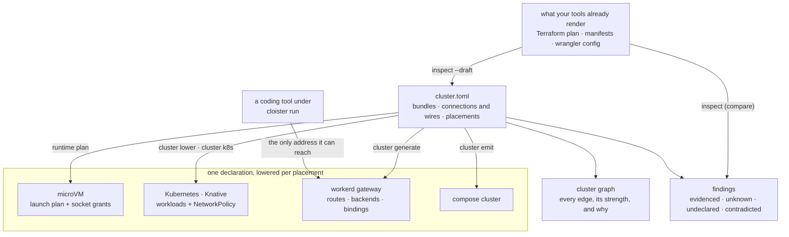

The gateway is not a second product. It is the workerd placement, plus the
front door: its public face is MCP over Streamable HTTP, and the same
TypeScript bundle runs under the `workerd` binary locally and on Cloudflare
Workers in production.

### Where it is not yet one thing

Stated here because a reader would otherwise find them one at a time
([ADR-0075](adr/0075-one-graph.md) §4):

- **A wire and a connection are two vocabularies for one statement.** The
  gateway's own edges are `[[wires]]`; everything else is `[[connections]]`.
  `cluster graph` shows both, but a wire cannot yet ask for a `minStrength`.
- **A wire under compose is held only for a socket in its own directory.**
  A target reached over HTTP is not held, and a caller that relays (the
  companion) extends its reach to whoever can reach it. `cluster graph` says which, and
  `task smoke:compose-hold` tries it against running containers.
- **workerd is not credited.** A binding is the strongest boundary here, and
  its strength reads `none` until a connection is lowered to one and checked.
- **An edge across two placements has no address.** A Kubernetes bundle
  calling a microVM one needs a broker that does not exist yet; every emitter
  refuses such an edge by name.
- **A secret does not reach a microVM by an env row.** The path into a guest
  is the vault.

This document covers the system as it is implemented today. The decisions
behind it are in the ADRs. Every one, with its **current** design status, is
in the generated [ADR index](adr/INDEX.md); it is derived from each ADR's
frontmatter and never restated here. Start with **0070 → 0074 → 0075** for
the declaration and what holds it, and **0001 → 0002 → 0007 → 0011** for the
gateway.

If you want to *run* cloister, start at
[../GETTING-STARTED.md](../GETTING-STARTED.md). For the reason behind a
decision, follow the linked ADR: the ADRs are the source of truth for why.

## Terms used here

| Term | Meaning |
| --- | --- |
| bundle | one deployable unit: a Worker or a container, with the bindings it is allowed |
| connection | a declared edge: this bundle may call that one |
| placement | where a bundle runs in one environment (for example Kubernetes in `prod`) |
| lease | a short-lived certificate a caller presents with each request; cloister verifies it and counts the call |
| attestation | a signed record that a caller wrote something, kept so the history can be audited later |
| receipt | a signed header on a response, so a caller can prove what cloister answered |
| Interlace | the identity and trust protocol the leases, attestations and receipts follow (ADR-0007) |
| bead | a tracked work item. `cloister-1a2b3c` is a bead id; they are cited here so the history of a decision can be found |
| ley-line-open (LLO), mache, rosary, notme | sibling projects: code intelligence and signing, a code graph, the bead tracker, and the identity service |

## Contents

- [Terms used here](#terms-used-here)
- [Where it is not yet one thing](#where-it-is-not-yet-one-thing)
- [Runtime model](#runtime-model)
- [From cluster.toml to a running gateway](#from-clustertoml-to-a-running-gateway)
- [Request routing — two layers](#request-routing--two-layers)
- [Sequence diagrams](#sequence-diagrams)
- [Transports](#transports)
- [Component map](#component-map)
- [Describing and checking a system](#describing-and-checking-a-system)
- [Bead store per repo](#bead-store-per-repo)
- [Content-addressing — two hash algorithms](#content-addressing--two-hash-algorithms)
- [Bindings](#bindings)
- [Packaging (melange + apko)](#packaging-melange--apko)
- [Lease verification](#lease-verification-adr-0007--adr-0053)
- [Running a tool under confinement](#running-a-tool-under-confinement)
- [Security surface](#security-surface)
- [Adversarial review rotation](#adversarial-review-rotation-adr-0020)
- [Where the code lives, and what gates it](#where-the-code-lives-and-what-gates-it)
- [Where to next](#where-to-next)

## Runtime model

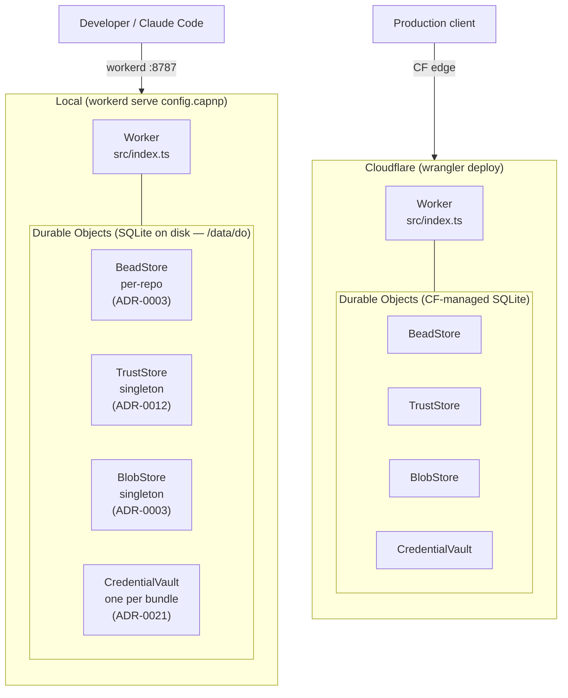

The code is identical. Storage differs: local disk vs Cloudflare-managed
Durable Object SQLite. Both use the same DO SQL API (`ctx.storage.sql`).
Tier classification per ADR-0011's three-criterion test: **BeadStore** is
bundle-tier (per-repo, idFromName(repo)); **TrustStore** and **BlobStore**
are hypervisor-tier singletons (idFromName("cluster")). **CredentialVault**
is keyed by bundle (idFromName(bundleIdName), ADR-0021), so one bundle's
credentials are a different object from another's.
The full hypervisor-tier DO map + the per-bundle topology live in
[`docs/reference/bundle-topology.md`](reference/bundle-topology.md).

## From cluster.toml to a running gateway

Nothing in `src/index.ts` names a route or a backend. They are declared, and
the declaration is generated.

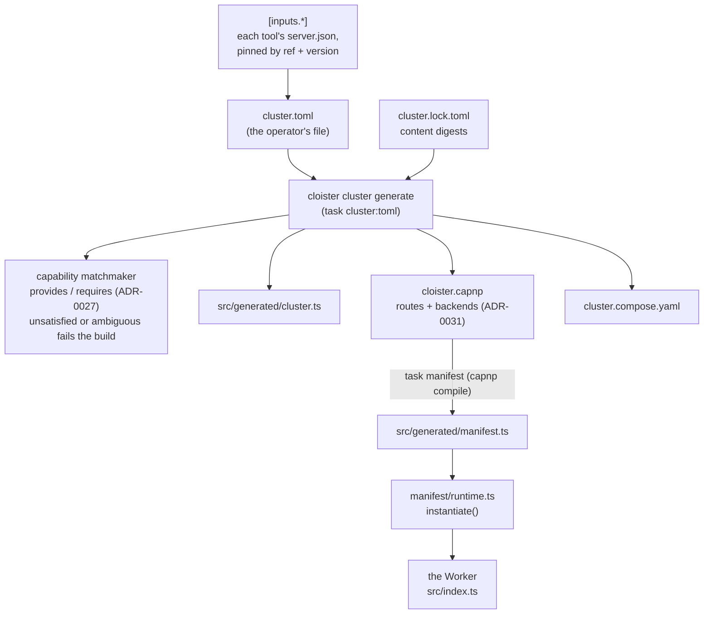

- **`cluster.toml` is the only file edited by hand.** `cloister.capnp`,
  `cluster.compose.yaml` and `src/generated/*` are committed and generated;
  `cluster:emit:check-drift` fails `task lint` when one does not match.
- **The schema is `manifest/cluster.capnp`.** It is projected to a strict zod
  schema, Go types, and the published JSON Schema for `cluster.toml`. The
  parser refuses a key the schema does not define.
- **Tools arrive as inputs.** An `[inputs.<name>]` row pins a tool's
  `server.json`; its tools become generated backends on `/mcp`. Adding a tool
  family is a row in `cluster.toml`, not a TypeScript file.
- **Two launch configs are kept in step by a rail.** `config.capnp` (workerd)
  and `wrangler.toml` (Cloudflare) each declare the bindings; see
  [Bindings](#bindings).

## Request routing — two layers

ADR-0002 introduces two small interfaces. The outer layer dispatches HTTP
requests to `EdgeRoute`s. The MCP edge route, in turn, dispatches tool
calls to `ToolBackend`s. Both tables are built from the manifest.

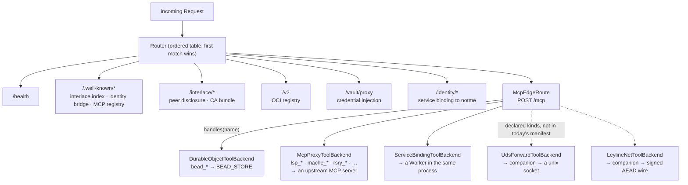

Today's manifest uses three of the five backend kinds: one `durableObject`
backend (beads) and many `mcpProxy` and `serviceBinding` backends, one per
tool family an input declares. The five kinds and when to use each are in
[`reference/backend-kinds.md`](reference/backend-kinds.md).

### EdgeRoute — HTTP/SSE multiplexing

Each `EdgeRoute` answers `match(request)` and `handle(request, env)`. The
router tries them in order; the first match wins, and falls through to a
404. Routes never see one another and never call back into the Router.

### ToolBackend — MCP tool dispatch

`McpEdgeRoute` aggregates a list of `ToolBackend`s. For `tools/list` it
returns the *union* of every backend's `tools()`. For `tools/call` it finds
the first backend whose `handles(name)` returns true and delegates
`invoke(name, args, env)`.

The route throws at construction if two backends advertise the same tool
name — duplicate-tool-name shadowing is loud, not silent.

## Sequence diagrams

### bead_create — local DO

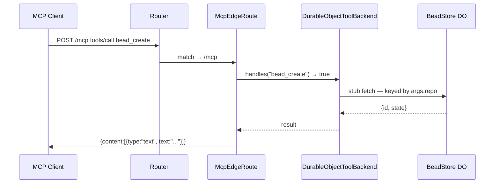

That is the path when the lease gate is off. When it enforces, `bead_create`
alone is intercepted and run by `routes/bead-create-orchestrator.ts`, which
writes the canonical bytes to BlobStore, creates the bead, and records an
attestation in TrustStore against the certificate that authorized the call
(ADR-0012). Other bead methods stay inside the one Durable Object.

### lsp_hover — MCP proxy to ley-line-open

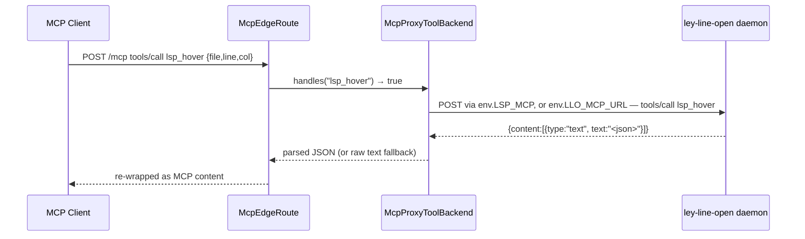

### Generic leylineNet via cloister-companion (ADR-0005)

> **Not in use today.** The diagram uses `rsry_status` as its example, but
> the current manifest reaches the `rsry_*` tools another way: an `mcpProxy`
> backend over the `ROSARY_BUNDLE` service binding (`cloister-c2bd47`). The
> `leylineNet` kind is kept for a tool that must be reached across hosts
> over an encrypted, signed wire.

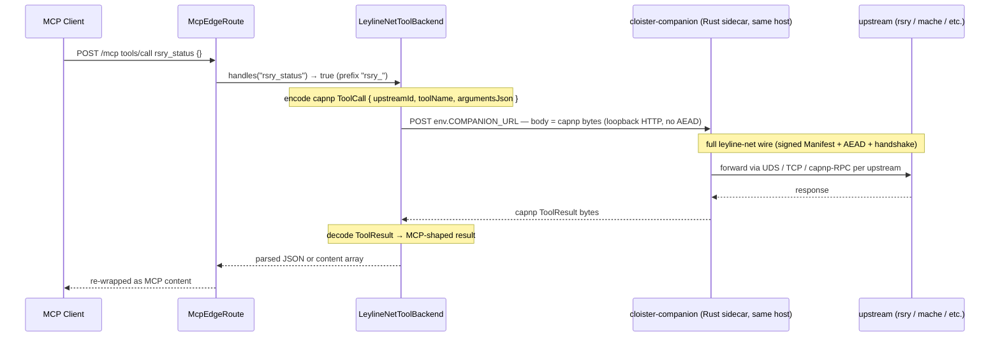

The cloister↔companion hop is **IPC** (loopback HTTP, no AEAD) per
ADR-0005's 2026-04-30 amendment. The full leyline-net wire — signed
capnp manifests, ChaCha20-Poly1305 AEAD, X25519 handshake — lives at
the companion↔backend hop where bytes traverse a real network.

### reparse — fired by the CC plugin

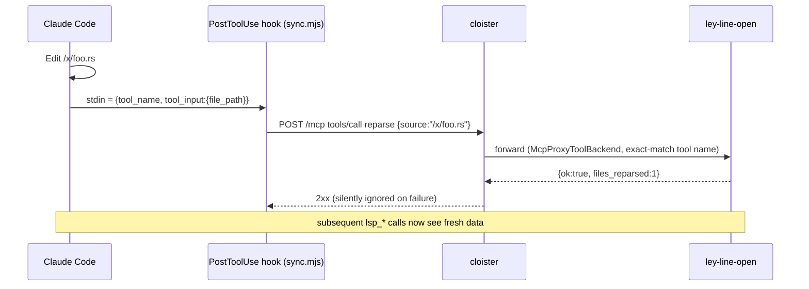

### /identity/* — service binding to notme

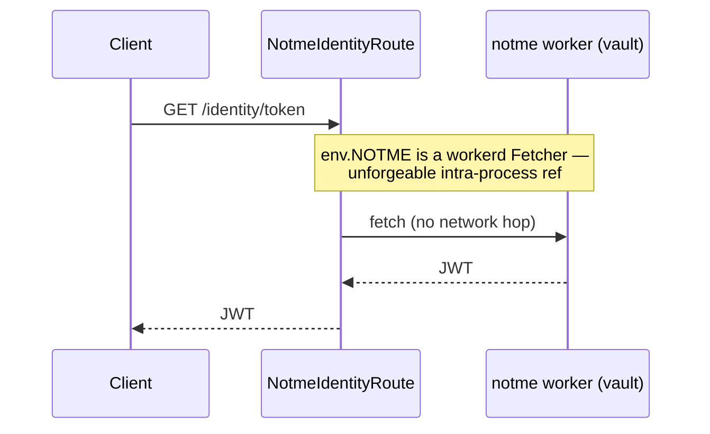

The notme vault has *no network*. It is reachable only through this service
binding, which is an unforgeable reference. cloister is the only thing on
the network in front of it. See ADR-0002 §"Capability boundary".

## Transports

The MCP face is **Streamable HTTP**: a client sends JSON-RPC in a `POST /mcp`
and reads the answer from that response. Every tool call above is one such
request. The protocol version cloister advertises is `2026-07-28`.

`GET /mcp` still answers with the older HTTP+SSE stream. That transport is
deprecated by the MCP specification and is kept only for its twelve-month
window; nothing new should be built on it.

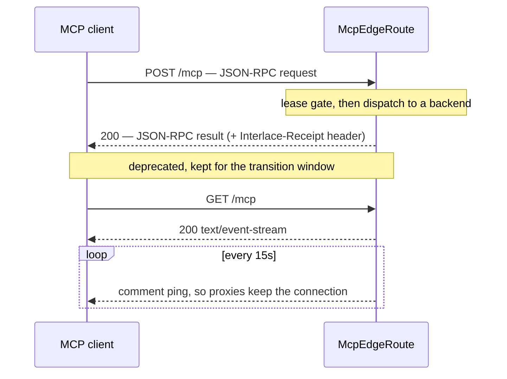

## Component map

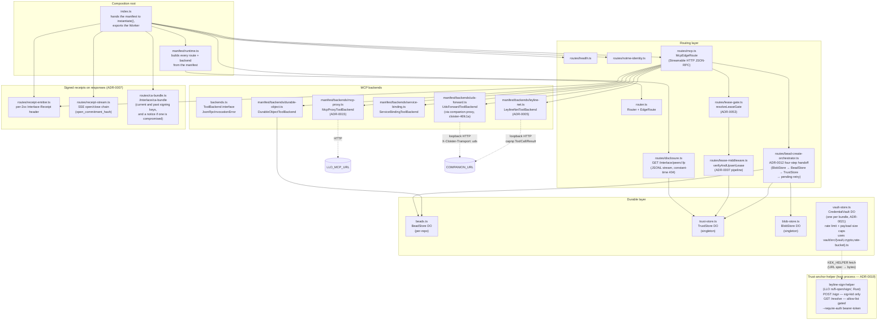

`router.ts` and `backends.ts` hold the two interfaces; `manifest/runtime.ts`
builds every route and backend from the manifest. A new route kind or backend
kind is a schema field, a TypeScript mirror, and a branch in `runtime.ts`
(ADRs 0002, 0005, 0015). A new *instance* of an existing kind is a line in
`cluster.toml`. The diagram shows the main modules, not every file:
`src/routes/` also holds the OCI registry, the vault proxy, tenant dispatch,
and the `.well-known` routes.

## Describing and checking a system

This part of cloister does not run anything. It reads, compares, and writes
files for you to apply. It is all in the `cloister` CLI (`cli/`).

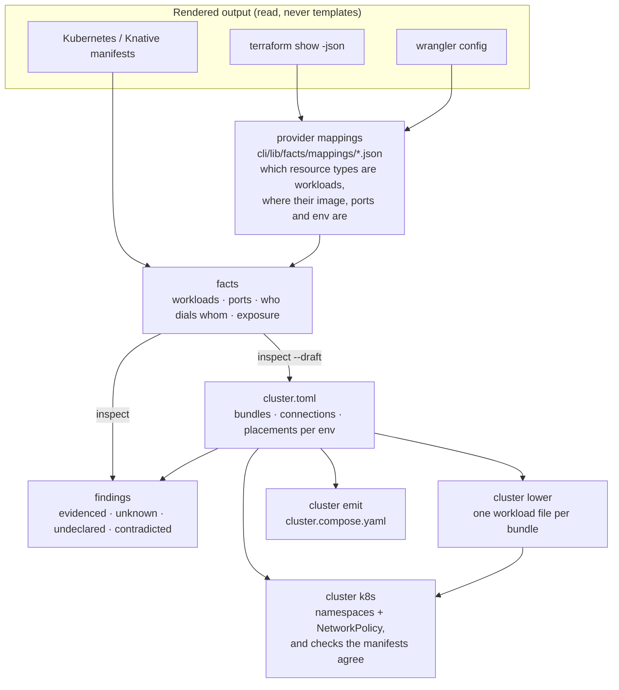

- **The graph is derived, the intent is declared** (ADR-0074). Who talks to
  whom is read from rendered output. What *should* be allowed, and how strongly
  it must be enforced, is in `cluster.toml`. A report says which is which: a
  finding is `evidenced`, `unknown`, `undeclared` or `contradicted`.
- **Nothing is provider-specific in the code.** A mapping file says which
  resource types of a provider are workloads and where their fields are.
  Cloud Run, Cloudflare and Kubernetes resources declared in Terraform are
  each a mapping. A type with no mapping is counted and named as not read.
- **An edge is never guessed.** A Kubernetes Service stands for a workload
  only when its selector matches exactly one. A caller is matched to an
  access grant by the identity the plan says it runs as, never by a similar
  name. A bundle is matched to a resource by name, and a placement row may
  state the name it goes by in that environment.
- **What cannot be read is declared, and said to be.** A secret's value is
  never read. An env row may declare that a secret holds a connection's
  address; reports then show the edge as declared, not observed.
- **`cluster.toml` is the one description every placement is lowered from.**
  A bundle's image, arguments and environment are declared once. An env value
  that is another bundle's address is a *binding* to a connection, because the
  address differs in every placement and each emitter writes its own: a
  cluster name on Kubernetes and Knative, the guest's loopback in a microVM.
- **A placement is where a bundle runs in one environment.** The kinds are
  `microvm` and `workerd` (cloister constructs these) and `kubernetes`,
  `knative` and `cloudRun` (cloister writes or checks files for these).
- **Enforcement strength is stated, not assumed** (ADR-0070). A connection may
  set `minStrength`; `cluster k8s` refuses when the placements at its two ends
  cannot deliver it. Knative, for example, can keep a Service off the outside
  network but cannot say which in-cluster caller may reach it without a mesh.
- **No values are printed.** A report names where a secret or address was
  found, never what it is.

Two CI jobs apply the lowered output to a real cluster (kind, and kind with
Knative) and observe the result: a declared caller connects, an undeclared
pod is refused. One scenario starts further back, from a rendered Terraform
plan: `inspect --draft` writes the `cluster.toml`, and it is lowered and
applied with no edit.

## Bead store per repo

Each repo gets its own Durable Object instance, keyed by repo path:

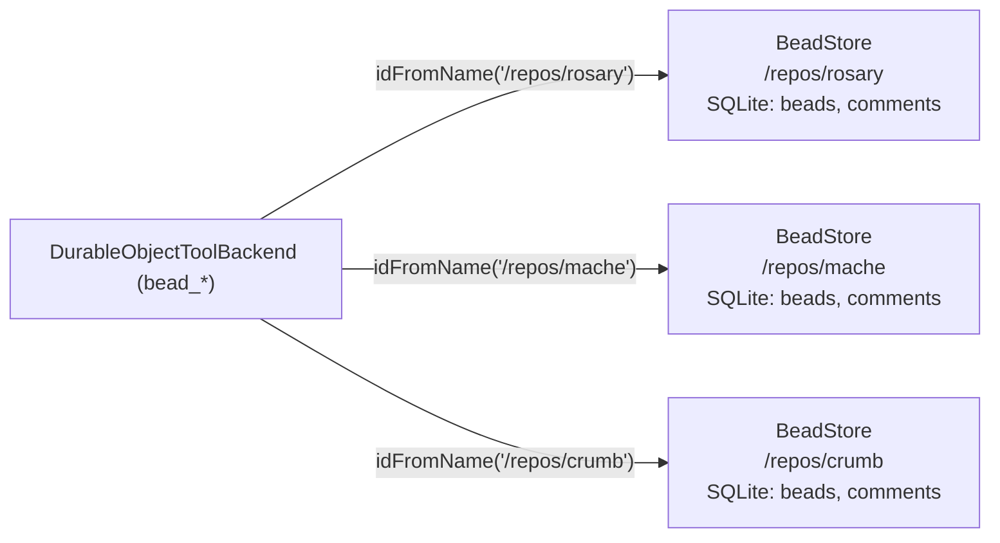

Isolation is physical: separate SQLite files, separate DO instances, no
shared state.

## Content-addressing — two hash algorithms

Cloister uses **two** content-addressing schemes at different layers:

| Layer | Algorithm | Implementation | Used for |
| --- | --- | --- | --- |
| Application | SHA-256 | `crypto.subtle.digest` (`src/storage/canonical.ts`) | Bead `content_hash`, attestation references, default `BlobStore` key, OCI tag verification |
| Storage | BLAKE3-256 | wasm32 FFI to LLO `leyline-cas-ffi` (`src/wire/cas-hash.ts`) | Blob identity in build-cache/v1, arena roots |

Both produce 64-character lowercase hex digests. The BLAKE3 path is
**synchronous** — CAS hashing is on the attestation / provenance path
and must never yield mid-digest.

**The build-cache/v1 wire overloads the OCI `sha256:` prefix with
BLAKE3 hex** — `sha256:<blake3-hex>`, not `sha256:<sha256-hex>`. This
is a deliberate v1 convention documented in
`leyline-schema-spec/build-cache/v1/wire/digest-encoding.md`. `BlobStore.put`
dual-verifies caller-provided keys against both algorithms
(`src/storage/workerd.ts`) so OCI-native and build-cache clients both
work.

## Bindings

Bindings are declared in two files, one per launcher: `config.capnp` for
`workerd serve` and `wrangler.toml` for Cloudflare. **Those files are the
list.** `lint:binding-parity` fails when a binding read in `src/` is not
declared on both paths, unless it carries a declared asymmetry, so this
section names the groups and what each is for, not every entry.

| Group | Bindings | Used for |
| --- | --- | --- |
| Durable Objects | `BEAD_STORE`, `TRUST_STORE`, `BLOB_STORE`, `VAULT_STORE` | beads, lease counters and attestations, content-addressed blobs, per-bundle credentials |
| Service bindings | `NOTME`, `NOTME_JWT`, `NOTME_RECEIPTS`, `LSP_MCP`, `MACHE_MCP`, `KEK_HELPER` | identity, token verification, receipt signing, tool upstreams, key-encryption-key resolution. A service binding is an unforgeable in-process reference, not a URL |
| Upstream URLs | `LLO_MCP_URL`, `MACHE_MCP_URL`, `ROSARY_MCP_URL`, `COMPANION_URL`, `SIGNET_URL` | where an `mcpProxy` backend or the companion is reached when there is no service binding |
| Trust anchors | `INTERLACE_ROOT_PUBKEY`, `INTERLACE_MASTER_PUBKEY`, `INTERLACE_DISCLOSURE_HMAC_KEY` | the lease gate's authority, cert-chain root, disclosure cursor signing |
| Receipts | `RECEIPT_SIGNING_KEY`, `RECEIPT_EPOCH`, `RECEIPT_ACTOR_FP`, `INTERLACE_ACTOR_FP` | signed response receipts |
| Vault | `VAULT_KEK_SOURCE`, `VAULT_KEK_TENANT_SCOPED` | where the key-encryption key comes from (a URL spec, ADR-0014) |
| Operator knobs | `CLOISTER_MODE`, `BEAD_STORAGE_BACKEND`, `ALLOWED_ORIGINS` | dev mode, bead storage path (ADR-0033), CORS allow-list |
| Dev only | `DEV_CA_MASTER`, `DEV_CA_EPOCH`, `DEV_VAULT_SEED`, `DEV_ALLOWED_SUBS`, `DEV_PASSTHROUGH_SERVICES` | read only when `CLOISTER_MODE=dev`; `lint:no-dev-mode` rejects committed dev material |

Each trust secret is read in exactly one resolver (`lint:lease-gate-source`,
`lint:trust-env-locality`). New credentials are vault slices on a bundle, not
new `[vars]` entries (ADR-0010).

**Environment of the signing helper.** `leyline-sign-helper` is a separate
host process that holds the master signing key (ADR-0019). These variables
are read by that binary, not by the Worker, so they are in neither
`wrangler.toml` nor `config.capnp`:

| Env var                            | Required? | Used by                                              |
| ---------------------------------- | --------- | ---------------------------------------------------- |
| `LEYLINE_SIGN_CALLER_TOKENS`       | Yes (prod; `--require-auth` fail-stops if unset) | bearer-token → caller-name map (ADR-0019 + threat-model §15.2) |
| `LEYLINE_SIGN_RESOLVE_ALLOW`       | Optional (deny-all if unset) | `/resolve` URL-prefix allow-list (threat-model §15.1; startup-validated per `cloister-9bee1f`) |
| `LEYLINE_SIGN_SIGN_ALLOW`          | Optional (overlay; deny-all if unset) | `/sign` URL-prefix allow-list overlay (ADR-0019 req 14) |
| `LEYLINE_SIGN_OP_BIN`              | Optional (defaults to `op` on PATH) | subprocess path for 1Password CLI `op://` scheme (ADR-0019 §"Implementation pins" → "Subprocess hardening") |
| `LEYLINE_SIGN_SECURITY_BIN`        | Optional (defaults to `/usr/bin/security`) | subprocess path for macOS `security` keychain CLI (same subsection) |
| `LEYLINE_SIGN_RESOLVE_TTL_MS`      | Optional (default 30000; `0` disables) | positive-cache TTL on `/resolve` (ADR-0019 §"Subprocess-scheme TTL cache amendment"; threat-model §17.7) |
| `LEYLINE_SIGN_RESOLVE_CACHE_MAX`   | Optional (default 1024) | FIFO eviction cap on `/resolve` cache (same amendment; threat-model §17.8) |

## Packaging (melange + apko)

cloister ships as a **distroless OCI image** built by `task image`. The
recipe lives in `melange.yaml` (APK build) + `apko.yaml` (image compose).

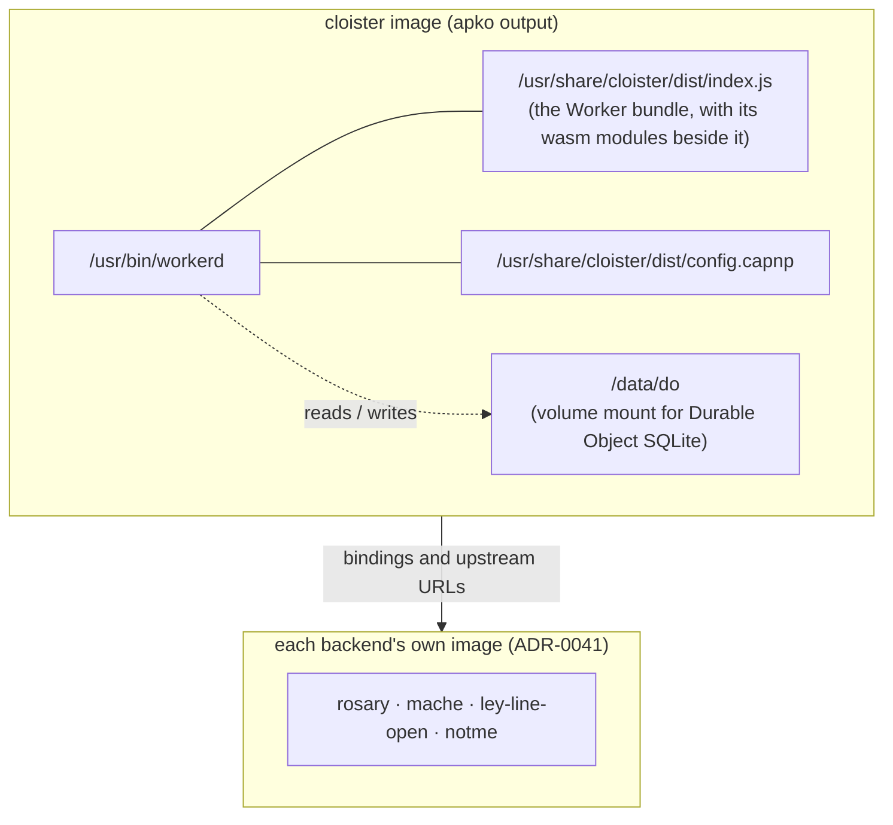

What `task image` produces:

- the workerd binary, the Worker bundle and `config.capnp`
- no shell and no package manager
- runs as uid 65532, not root
- starts as `workerd serve --experimental /usr/share/cloister/dist/config.capnp`
- declared for two architectures, `x86_64` and `aarch64`. A local
  `task image` builds the host's only
- packages from the same upstream share a layer, so an update pulls only the
  layer that changed

Each backend publishes its own image from its own repository (ADR-0041).
Keeping them out of cloister's image is what lets cloister's stay this
small: a backend that needs a shell, subprocesses or a writable volume has
them in its image, not this one.

`task image:check` parses `melange.yaml` + `apko.yaml` end-to-end without
running a real build — useful in CI before bumping versions.

## Lease verification (ADR-0007 / ADR-0053)

Tracked in `cloister-bd7770` (the pipeline) and `cloister-b89fdb` (wiring it
into `/mcp`).

Every authenticated `POST /mcp` call is verified by
`src/routes/lease-middleware.ts:verifyAndUpsertLease` before reaching
the JSON-RPC dispatch. The pipeline:

1. **Header parse** — `Authorization: Signet <base64-cert-DER>`,
   `X-Signet-Sig`, `X-Signet-Ts`, `X-Signet-Nonce`. Malformed headers
   short-circuit to JSON-RPC error code -32001 / HTTP 401.
2. **Cert chain verify** — `verifyCertChain` (TS wrapper around
   wasm32-built `leyline-sign`) checks the cert is signed by the active
   master in the CA bundle, falling back to the previous master during
   a rotation window. Source: LLO `rs/ll-open/sign/src/cert_chain.rs` →
   `src/wire/signet-verify.ts`.
3. **Claims required** — the cert must carry `epoch` + `peer_fp` + `scope`
   (Interlace OID extensions at `1.3.6.1.4.1.99999.1.{4,5,6}`). Certs
   without them fail closed.
4. **Epoch currency** — `isCertEpochCurrent` accepts the current bundle
   epoch and (during a rotation window) `bundle.epoch - 1`.
5. **Validity window** — server clock ∈ `[not_before, not_after]`.
6. **Request signature** — `crypto.subtle.verify("Ed25519", …)` over
   `canonicalRequestBytes(method, url, ts, nonce, body)`. Web Crypto's
   raw-key import path; no extra wasm hop.
7. **Scope match** — `scopeAllows(cert.scope, deriveRequestScope(...))`.
   Glob semantics: `X:*` matches any `X:Y`; `*` matches anything (admin
   only).
8. **Lease counter UPSERT** — `TrustStore.upsertLeaseCounter(...)` via
   workerd RPC. Every authenticated call is counted, so a caller with no
   count provably made no call (ADR-0007 §13.2).

The pipeline is end-to-end tested in `test/routes/lease-middleware.test.ts`
and wired into `McpEdgeRoute.handlePost`.

**Whether it runs is decided in one place**, `resolveLeaseGate`
(`src/routes/lease-gate.ts`, ADR-0053):

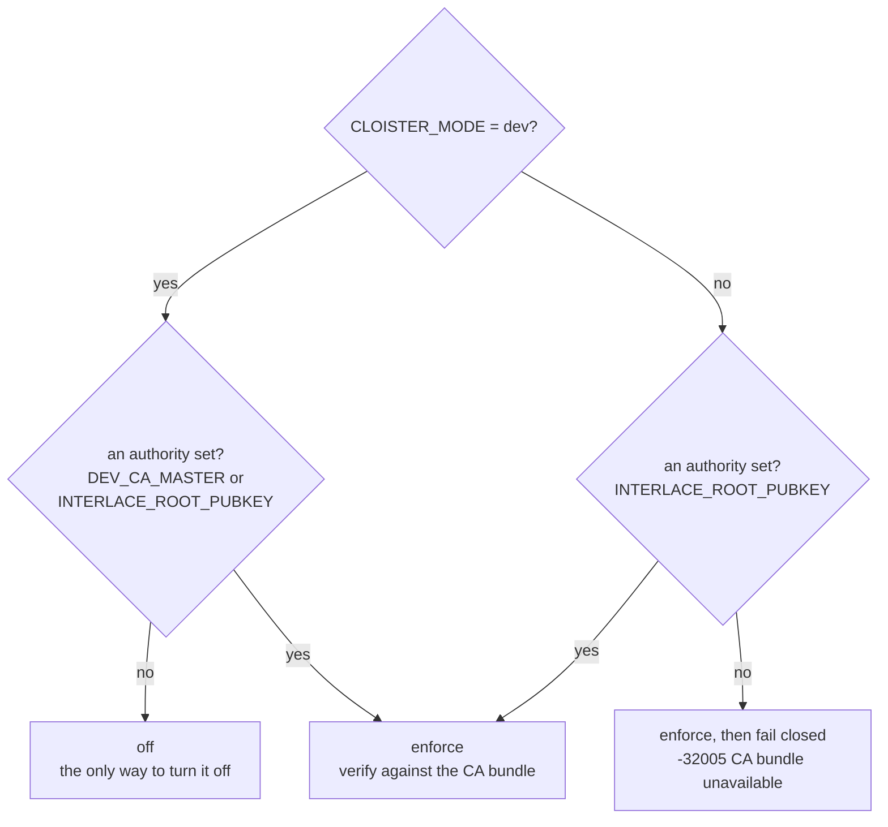

Unsetting `INTERLACE_ROOT_PUBKEY` alone does **not** disable the gate: outside
dev mode, no authority means every request is rejected. There is no
per-request bypass (`INTERLACE_DEV_BYPASS` was removed by the 2026-05-08
ADR-0007 amendment). The granularity is the deployment's bindings.

## Running a tool under confinement

Everything above describes cloister as a **server**: routes in, backends out.
There is a second execution model, and it is what `cloister run` uses — cloister
as the **only thing a coding tool can reach**.

```
cloister run --harness claude-code --repo /abs/path/to/repo
```

The tool runs on your machine, not in a container. What changes is what the
kernel will let it touch.

### The boundary is the kernel, not a wrapper

Confinement is applied by the `nono` crate, consumed as a **library** (pinned at
`nono = "0.70"` in `tools/harness-sandbox/Cargo.toml`), which maps one declared
policy onto Seatbelt on macOS and Landlock on Linux. Consuming it as a library
rather than shelling out to its CLI matters: the CLI seeds some grants of its
own, so the two do not enforce the same thing. The
launcher builds the policy; `cloister-harness` applies it and then `exec`s the
tool.

Two properties follow, and the design depends on both:

- **It is not advisory.** There is no shim to bypass and no environment variable
  to unset. A denied read returns `EPERM` from the operating system.
- **It is inherited.** Descendants cannot escape it, so a skill's shell script
  that runs Python that runs `curl` is bounded by the same policy. Verified
  three levels deep across a language boundary in
  `tools/harness-sandbox/test/`.

Grants are a **union, not an intersection** — this is the part that surprises
people. Adding a read grant for a subdirectory does **not** narrow a writable
parent, and `deny` is a full deny rather than a write-deny. So the way to make
something read-only is to **move the bytes**, not to add a narrower grant.

### What the policy actually says

| | |
|---|---|
| the repos passed with `--repo` | read + write |
| a per-run scratch directory | read + write |
| system paths needed to execute anything | read only |
| everything else — other repos, `~/.ssh`, `~/.aws`, shell history | denied |
| the network | denied before a packet leaves |
| `127.0.0.1` → cloister | the single reachable destination |

That last row is the point of the whole design. Cloister is not *a* way for the
tool to reach the outside — it is the **only** way, which is what makes the
tools it serves auditable rather than merely available.

The allow-list of system paths was **discovered by hitting errors**, not derived
from a specification. Making `git` work took `/var`, `/etc`, `~/.config/git`,
`~/.gitconfig` and `~/.gitignore_global` — each found when something failed. It
is complete only up to what has been exercised (`cloister-cd30a6`).

### The policy is committed to before it is applied

The policy is not merely built and used. A run mints an ephemeral identity whose
certificate carries a digest of the confinement **shape**, and `cloister-harness`
recomputes that digest over the manifest it is about to enforce and compares —
**before** the irreversible `apply`. A mismatch stops the run.

```
cloister-harness: §7 confinement commitment verified —
  the manifest to be enforced matches the identity-committed digest
```

The digest covers symbolic paths rather than absolute ones, so it is identical
whichever repos you pass and different for how *many*. This is what makes "the
tool ran confined" a checkable claim rather than a launcher's assertion. Per
ADR-0053 and the threat model's §7.

### Credentials never enter the tool's environment

Two lanes, chosen by whether `ANTHROPIC_API_KEY` is set:

- **Custody** — the key is vaulted and injected at the proxy. The tool's
  environment never holds it, so a compromised tool cannot exfiltrate what it
  cannot read. This is `cloister/credential-isolation/v1` (ADR-0024), and every
  call emits a signed receipt.
- **Audit** — no key vaulted; whatever authentication the tool already had is
  forwarded, and calls are still receipted. Under confinement this is often
  *unauthenticated*, because a Claude subscription authenticates through the
  macOS keychain and the sandbox denies keychain access by design. The launcher
  says so before minting anything rather than letting it surface as a confusing
  "not logged in".

### A run owns its processes

`cloister run` starts cloister itself, a lease shim, optionally companion
Workers, and the tool. Each is spawned into **its own process group**, and
teardown signals the group.

This is not tidiness. `task dev` starts wrangler which starts workerd — those
are grandchildren, and killing only the leader left them holding ports. Because
wrangler silently moves to the next free port when one is taken, a later run
would bind 8788 while its health check polled 8787 and got a healthy response
**from the stale server**: every signal said fine while the tool talked to an
old build. A fail-closed port preflight now refuses to start on a held port.
Per `cloister-de4c78`.

### Where the code lives

| | |
|---|---|
| `cli/lib/harness/launch.mjs` | the orchestration — plan, setup, launch |
| `cli/commands/run.mjs` | `cloister run`, calls `launch()` in-process |
| `tools/harness-sandbox/` | the Rust binary that applies the policy and execs |
| `src/harness-shim/` | the localhost endpoint the tool is allowed to reach |
| `docs/RUNNING.md` | the operator walkthrough, including known gaps |

Design decisions: ADR-0042 (turnkey local run), ADR-0044 and ADR-0050
(compute isolation), ADR-0049 (host runtime), ADR-0060 (a tool's selector is not
its executable), ADR-0061 (skills declared and digest-verified).

## Security surface

Each row is one place an attacker could push, what could go wrong there, and
what stops it. The last column says where the decision and its history are.

| Where | What could go wrong | What stops it | Tracked in |
| --- | --- | --- | --- |
| `POST /mcp` | A request runs without proving who sent it | Every POST goes through the lease pipeline above: certificate chain, clock skew, request signature, scope, replay check, call counter. Whether it runs is decided in one place, `resolveLeaseGate`: off only in explicit dev mode with no authority, and rejecting everything when there is no authority outside it | ADR-0007, ADR-0053, `cloister-b89fdb` |
| `POST /mcp` response | A caller cannot prove what cloister answered | Every authenticated 2xx response carries a signed `Interlace-Receipt` header covering the request, the body, selected headers, the time and the signer. A stream gets a paired receipt at open and at close. `/interlace/ca-bundle` publishes current and past signing keys, and a notice if one is compromised. With `RECEIPT_SIGNING_KEY` unset nothing is emitted | ADR-0007 §13.2, `interlace-spec/0.2.0-draft/RECEIPTS.md` |
| `GET /interlace/peers/{fp}` | Learning whether a peer exists, or how long its history is, from how the endpoint answers; forged history; replaying a page cursor for another peer | Not found, denied and bad cursor return byte-identical 404s in constant time. Cursors are HMAC-signed and bound to one peer. Lease-gated whenever the gate enforces (scope `disclosure:<fp>`), and an auth failure is the same 404. The stream includes the cluster's public key so it can be verified offline. Reviewed 2026-05-12 | ADR-0007 §11, threat model §9 and §16 |
| Vault `proxyRequest` / `putCredential` | One caller exhausts the vault in a tight loop; an oversized payload blocks the single-threaded object | A per-caller token bucket (`vault/src/rate-bucket.ts`): reads cost 1, writes 3, proxied requests 5; capacity 100, refill 10 per second. It is stored in SQL, so evicting the object does not refill an attacker's budget. Payload caps (`validateCredentialPayload`): 32 headers, 16 KiB, 64 allowed subjects, checked before anything is encrypted or written. Reviewed 2026-05-12 | `cloister-211b68` (rate limit), `cloister-21b5eb` (size caps) |
| Vault 403 vs 404 | A caller learns which credential names exist from the status code | **Open.** Not reachable today, because only the router calls the vault; it becomes reachable with the first other bundle. The fix is to answer 404 for both, do the same work on both paths, and keep the real reason in logs only | threat model §16.1, `cloister-aa9376`, ADR-0021 |
| Signing helper (`leyline-sign-helper`) | The master key leaks through a response; another local user calls it; a browser is tricked into calling it; an oversized body | A separate Rust process (LLO `rs/ll-open/sign/`). `POST /sign` returns a signature and key id, never key bytes. Per-caller bearer tokens. Only `Content-Type: application/json` is accepted, which a cross-site form cannot send. Bodies are capped at 64 KiB. `--require-auth` refuses to start without tokens. `/resolve` denies by default | ADR-0019, threat model §15 and §15.A; `cloister-7aaab1`, `cloister-7afedc`, `cloister-7b5b9d`, `cloister-7c2179`, `cloister-7c737a`, `cloister-7cd202` (first review), `cloister-9bd96c` (second review) |
| BeadStore SQL | Injection | Parameterized queries throughout | |
| TrustStore SQL | Injection; a replayed request; a forked history | Parameterized queries, one object so writes are atomic. A seen-nonce table rejects a replayed request. The attestation chain rejects a fork | `cloister-c5c846` (replay), `cloister-bdcbe7` (chain integrity) |
| Upstream calls (notme, LLO, rosary) | A request makes cloister call an address the attacker chose | The upstream is never taken from a request. `NOTME` is a service binding; `LLO_MCP_URL` and `ROSARY_MCP_URL` are deployment config | |
| CORS | Any origin in local dev | `ALLOWED_ORIGINS` sets an allow-list; other origins get `null`. See `src/cors.ts` | |
| notme vault | Reaching it from the network | It has no network. It is reachable only through the service binding | ADR-0002 |
| Container | A shell, a package manager, or root inside the image | Distroless image: no shell, no package manager, runs as uid 65532 | |

## Adversarial review rotation (ADR-0020)

Security is reviewed by attacking it on a schedule. ADR-0020 defines seven
reviewer roles, each looking for one kind of failure:

| Role | Looks for |
| --- | --- |
| `dos-resilience-auditor` | ways to exhaust a resource, or starve other callers |
| `enumeration-oracle-hunter` | answers that leak whether something exists, by timing or by shape |
| `bundle-isolation-tester` | one bundle reaching another's credentials; a misdeclared manifest |
| `protocol-replay-adversary` | replayed requests, stale certificates, forked histories |
| `trust-root-adversary` | tampering with the signing helper or its key storage |
| `observability-gap-auditor` | failures that are silent, or alerts that fail under load |
| `adversarial-synthesis-lead` | combines the findings and owns the threat model |

Reviewers only read. They file a bead for each finding, tagged
`red-team:<class>`, and do not patch. The lead writes the findings into
[`docs/security/threat-model.md`](security/threat-model.md) and a report under
`docs/security/adversarial-cycles/<date>.md`. The first three reviews ran on
2026-05-12: eleven findings, eight fixed the same day, three tracked as beads.

## Where the code lives, and what gates it

| Directory | Holds |
| --- | --- |
| `src/` (tests in `test/`) | the Worker: router, routes, backends, Durable Objects, wire codecs |
| `cli/` | the `cloister` command, the only part that ships to an operator's machine |
| `manifest/` | the capnp schemas: `cloister.capnp` (gateway) and `cluster.capnp` (cluster.toml) |
| `lint/` | the rails `task lint` runs |
| `gen/` | code generators and build steps |
| `dev/` | local launchers, smoke tests, git hooks |
| `rs/`, `tools/harness-sandbox/` | Rust: bridge crates to ley-line-open, and the confinement launcher |

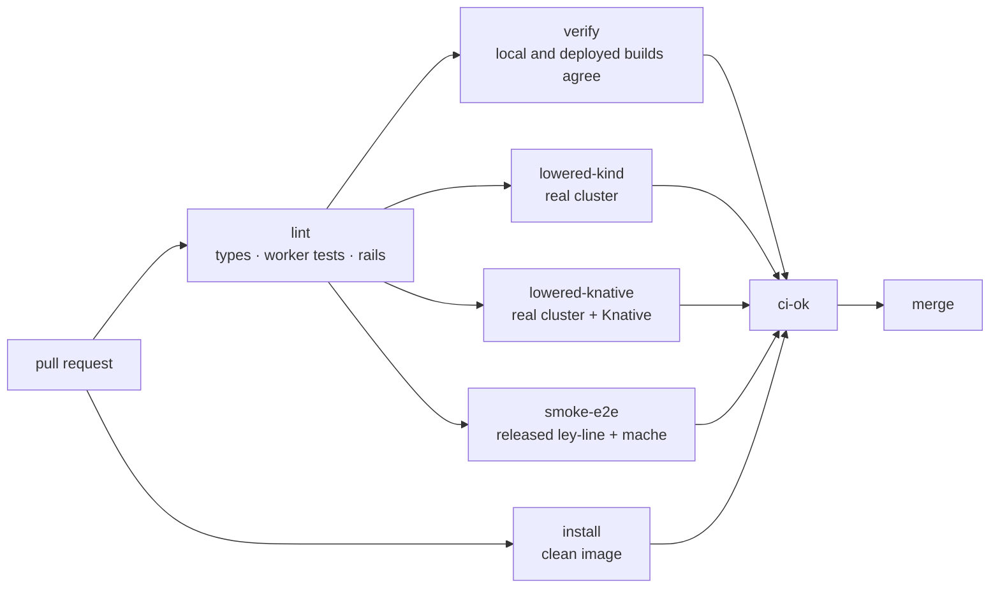

`ci-ok` needs every job and is the one check to require. A rule stated in an
ADR or a comment gets a rail in `lint/` in the same change, with a test that
runs against the real tree: an invariant with no rail is a comment.

## Where to next

- Set it up: [../GETTING-STARTED.md](../GETTING-STARTED.md)
- Check the security claims: [security/threat-model.md](security/threat-model.md)
  (§§9.4.b, 13.2, 13.4, 13.6, 15, 16), and the review reports under
  [security/adversarial-cycles/](security/adversarial-cycles/)
- Add a new MCP tool family: add an `[inputs.<name>]` row to `cluster.toml`
  and run `task cluster:toml`. No TypeScript edits in `src/index.ts`
- Add a new route or backend *kind*: a schema field, its TypeScript mirror,
  and a branch in `src/manifest/runtime.ts`, after an ADR
- Describe a system you already run: `cloister inspect --terraform plan.json
  --draft --env prod`, described in the [README](../README.md)
- Change the wire, the trust boundary, or a schema: draft a numbered ADR in
  `docs/adr/` (0037 reserved for secure MCP ingress; the current list +
  status is the generated [ADR index](adr/INDEX.md), never hand-counted;
  rules at the top of each ADR file)
- Claude Code stale-sync plugin contract: owned by ley-line-open at
  [`wrappers/claude-code`](https://github.com/agentic-research/ley-line-open/tree/main/wrappers/claude-code).
  Cloister's `cloister-stale-sync` was retired 2026-07-27 (ADR-0035: LLO
  owns the parse / LSP surface)
